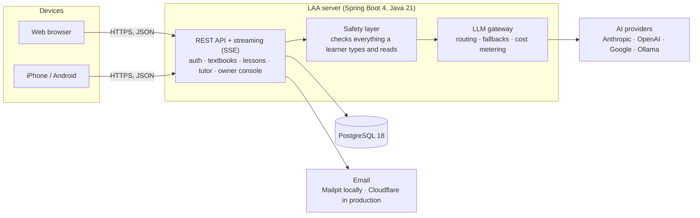

# Learn Anything Anywhere

LAA turns a learner's *why* into a personal textbook. A short interview (the preface) finds out what they want to be able to do and why. Then LAA writes lessons for them one at a time, with practice questions and a tutor who helps without handing over the answer. It's an Expo app (web, iOS and Android) and a Spring Boot server, and it's heading from prototype to the web, the App Store and Google Play (`docs/PRODUCTION-PLAN.md`).

**New here? Read this page, then [`docs/WORKFLOW.md`](docs/WORKFLOW.md), and you're ready for your first task.**

## How it fits together



- **The app** (`app/`) is one Expo codebase for all three platforms: React Native, Expo Router and TanStack Query.
- **The server** (`server/`) owns all the data and every AI call. A learner's request reaches a model only through the **safety layer**, and every model call goes through the **LLM gateway**. Which model does which job, and what it costs, is set in the owner console.
- **In production**, Caddy sits in front on one Hetzner server, serving the web app and passing API calls to the server, with Postgres beside them in Docker Compose (`deploy/`, explained in `docs/DEPLOYING.md`).

## Your first hour

**You need:** Docker Desktop, a Java 21 JDK, Node.js (current LTS) and git. The GitHub CLI (`gh`) helps too. You don't need any AI keys: locally, LAA uses *practice mode*, which gives scripted replies.

```sh
git clone https://github.com/bernardodr/LearnAnythingAnywhere.git
cd LearnAnythingAnywhere
cp .env.example .env
```

In `.env`, set `JWT_SECRET` to the output of `openssl rand -hex 32`. If port 5432 is already in use on your machine (Postgres.app, say), set `POSTGRES_PORT=5433` and change `DATABASE_URL` to match. Then:

```sh
./dev.sh
```

That starts Postgres and Mailpit in Docker, the server on `:8080`, and the web app on `:8081`, and opens your browser.

- **Sign in** with *Developer sign-in* and any email. You don't need a password, and the email counts as confirmed. Use `owner@laa.dev` to see the owner console (`/owner`).
- **Emails** the app sends (confirmation and reset links) appear in Mailpit at http://localhost:8025.
- **On a phone:** set `EXPO_PUBLIC_API_URL` in `.env` to your laptop's LAN address, then scan the QR code with Expo Go.

Check that everything passes before you change anything:

```sh
cd server && ./mvnw test                                  # needs Docker (Testcontainers)
cd app && npm run typecheck && npx expo lint
./e2e/run.sh diagrams                                     # the real web app in headless Chrome (needs Google Chrome)
./e2e/production.sh                                       # the production containers, deployed and checked locally (after changing deploy/)
```

## Find your way around

| Where | What's there |
|---|---|
| `app/src/app/` | The screens (Expo Router: the file name is the route) |
| `app/src/components/` | The shelf, covers, lesson blocks, tutor, settings, owner console panels |
| `app/src/lib/` | The API client, the session (sign-in token), streamed replies |
| `server/.../llm/` | The LLM gateway: every model call, registered in `Calls`, plus routing, providers and the run log |
| `server/.../safety/` | The safety layer: topic gate, content checks, links policy, leak checks |
| `server/.../mission/`, `lesson/`, `tutor/` | The preface interview, lesson writing (with checks), practice and the tutor chat |
| `server/.../auth/`, `profile/`, `mail/` | Sign-in, passwords, the parent PIN, reader settings, email |
| `server/src/main/resources/` | `application.yml` (settings, AI models and prices), prompts, database migrations |
| `deploy/` | Production: the two images, the Compose file, Caddy's config, `deploy.sh` and the production `.env.example` |
| `e2e/` | Browser walk-throughs: the diagrams' sealed frame, and the production stack |

## The developer docs

| Document | Read it for |
|---|---|
| [`docs/WORKFLOW.md`](docs/WORKFLOW.md) | **How work gets done:** tasks, branches, pull requests, deploys and store releases, with diagrams |
| [`docs/DATABASE.md`](docs/DATABASE.md) | The tables, how they relate, what deleting does, and how to change the database |
| [`docs/DEPLOYING.md`](docs/DEPLOYING.md) | What runs on the server, putting a version live, rolling back, restoring a backup |
| [`docs/EMAIL.md`](docs/EMAIL.md) | The emails LAA sends, the link flows, limits, and the email setup in each environment |
| [`docs/BRIEF.md`](docs/BRIEF.md) | **The spec:** what LAA is meant to be. Read its section before starting a milestone. |
| [`GLOSSARY.md`](GLOSSARY.md) | The domain words (safety layer, reader settings, shown text, held back, …). Use them in code and docs. |
| [`CLAUDE.md`](CLAUDE.md) | Every convention and gotcha, kept for the AI assistant that builds alongside you, and the most complete rule list there is |
| [`docs/PROGRESS.md`](docs/PROGRESS.md) | What's done, how each part was tested, and every decision so far, with the reasons |
| [`docs/PRODUCTION-PLAN.md`](docs/PRODUCTION-PLAN.md) | The road to the web, the App Store and Google Play |
| [`docs/product/`](docs/product/) | The user guide and release notes, written for learners, parents and the owner |

## The rules that matter most

1. **Secrets live only in `.env`**, which is never committed; `.env.example` holds placeholders. This repo is public: anything pushed is published.
2. **`main` changes only through a pull request**, which the owner merges (`docs/WORKFLOW.md`).
3. **Model calls go through the LLM gateway, and learner flows through the safety layer.** A test (`ArchitectureTest`) fails if they don't.
4. **Code explains itself:** every class, package and public method has a doc comment in plain sentences, saying what it does and why (`CLAUDE.md`, issue #56).
5. **The tutor never hands over the answer.** Rubrics and lesson plans never leave the server.
6. **Anything people can see** gets a user-guide entry and release notes in the same pull request, in plain words.
7. **Ask before adding a dependency**, and record it in `docs/PROGRESS.md`.

## Where the work is

The [LAA production board](https://github.com/users/bernardodr/projects/1) holds every task. Each is a [GitHub issue](https://github.com/bernardodr/LearnAnythingAnywhere/issues), grouped by phase. The label `you` marks the owner's own steps.
