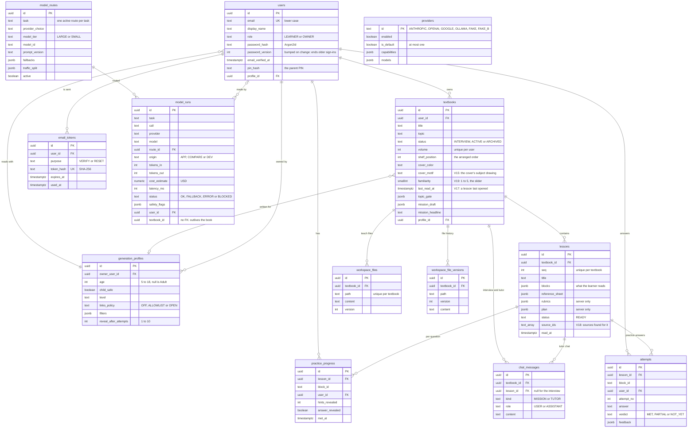

# The database

LAA keeps everything in one **PostgreSQL 18** database: 13 tables, built by the Flyway migrations in `server/src/main/resources/db/migration/` (`V1` to `V13`). The server reads and writes it with `JdbcClient` and plain SQL, not JPA. This page is for developers; for the words used here (reader settings, held back, …) see `GLOSSARY.md`.

Read from the local database on 2026-11-17, after `V13`; `V14` (2026-11-18), `V15` (2026-11-24), `V16` to `V19` (2026-11-26) are noted where they change things. When a migration changes the structure, update this page in the same pull request.

## Conventions

- **Every table** has a UUID primary key `id` (`gen_random_uuid()`), `created_at`, and `updated_at`. The `set_updated_at()` trigger from `V1__baseline.sql` keeps `updated_at` current.
- **Fixed values are `text` with a `CHECK`**, never a Postgres enum (e.g. `users.role IN ('LEARNER','OWNER')`). Adding a value is a migration that replaces the check.
- **Structured content is `jsonb`**: lesson blocks, rubrics, filters, routing fallbacks.
- **Secrets are stored only as hashes**: `password_hash` and `pin_hash` (Argon2id), `email_tokens.token_hash` (SHA-256). None of them ever leaves the server.
- **Ownership is checked in SQL**: a learner's textbook is loaded with `TextbookRepository.requireForUser`, and another user's id is a 404.

## The map



## The tables

### People and sign-in

| Table | What it holds | Rules worth knowing |
|---|---|---|
| `users` | One row per account (adults only): email, display name, role, password hash and version, when the email was confirmed, the parent PIN hash, and the account's reader settings. | `email` is unique and lower case. `role` is `LEARNER` or `OWNER`. A forgotten PIN is replaced with the password. There are no child accounts. |
| `generation_profiles` | **Reader settings** (the brief's "generation profile"): age, child-safe, level, links policy, filters, and after how many tries an answer may be shown. One per account. | `age` is 5–18, or null for Adult. Changing it needs the parent PIN once one is set. |
| `email_tokens` | Emailed links: confirm-email (24 hours) and password reset (30 minutes). | Only the SHA-256 of a link is stored, so a database leak gives away no working links. Each link works once (`used_at`). A new link cancels older ones. |

### Books and learning

| Table | What it holds | Rules worth knowing |
|---|---|---|
| `textbooks` | A learner's book: title, topic, status, volume number, cover colour and cover motif, shelf position (its place in the library), the topic gate's verdict, and the mission. | `volume` is unique per user. Arranged books (`shelf_position`) are listed first, then the rest by volume. `cover_motif` (V15) is a lower-case name from `Motif.java`, saved when the preface is confirmed; while it's null the server matches one from the title when it shows the book. `last_read_at` (V17) is stamped whenever one of its lessons is opened (`GET /textbooks/{id}/lessons/{seq}`). `familiarity` (V19) is the slider's level when the book was started (1 brand new to 5 very confident), given to the AI as `{{familiarity}}`. |
| `lessons` | A written lesson: title, subtitle, the *win*, the mission link, the blocks the learner reads (an interactive diagram is a block holding its page, text version and caption), a reference sheet. | Only `LessonChecks` can produce a lesson to store. **`rubrics` and `plan` never go to the app.** `seq` is unique per textbook. `source_ids` (V18) are the sources found for it when it was written (issue #82); the lesson shows those and any it cites at its end. |
| `attempts` | Each answer to a practice question, with the grader's verdict and feedback. | Unique per (lesson, block, user, attempt number). |
| `practice_progress` | Per question and learner: hints shown, whether the answer was shown, when it was met. | One row per (lesson, block, user). |
| `chat_messages` | The preface interview (`MISSION`) and the tutor chat (`TUTOR`, tied to a lesson). | Saved only after a turn finishes. |
| `workspace_files` | The `/teach` files of a textbook (`MISSION.md` and the rest), current content. | One row per (textbook, path). |
| `workspace_file_versions` | Every earlier version of those files. | One row per (textbook, path, version). |

### AI and running costs (the owner console)

| Table | What it holds | Rules worth knowing |
|---|---|---|
| `providers` | The AI services, their models, tiers, capabilities and prices. | **Synced from `application.yml` on every start**: change models there, never here. At most one default. |
| `model_routes` | For each task (interview, lesson writing, diagrams, grading, safety check, …), which provider and tier, the prompt version, fallbacks and traffic split. | One active route per task. Changed in the owner console. |
| `model_runs` | Every AI call: task, provider, model, tokens, estimated cost, time taken, outcome, safety flags, and who it was for. | The daily spending caps add up `cost_estimate` since midnight UTC. Kept when a user or book is deleted, without the person. |

## What deleting does

| Delete a… | Also deleted | Kept | Blocks it |
|---|---|---|---|
| textbook | its lessons (and their attempts, progress and tutor chat), interview chat, files and file history | its AI runs | — |
| lesson | its attempts, progress and tutor chat | — | — |
| user | their email links | their AI runs (`user_id` set to null) | **their textbooks, reader settings, attempts and progress**, which must be deleted first |

The last row is what *Delete your account* (issue #14) has to handle, in one transaction.

## Changing the database

1. **Add a new migration**: `server/src/main/resources/db/migration/V20__what_it_does.sql`. **Never edit one that has already run.** Flyway checks every applied file's checksum and refuses to start if one changed.
2. Follow the conventions above: a UUID key, `created_at`/`updated_at` with the trigger, checks for fixed values.
3. **Data changes are one-way.** A migration that deletes or rewrites rows can't be undone by reverting the code. Say so under *Merge Danger* in the pull request, and back up first once production exists (Phase 3 sets up nightly backups).
4. Run `cd server && ./mvnw test`: the tests start a fresh `postgres:18` (Testcontainers) and run every migration from `V1`. `./dev.sh` runs new migrations against your local database on the next start.
5. Update this page.

### Looking at the local database

```sh
docker compose exec postgres psql -U laa -d laa
```

Then `\dt` lists the tables, and `\d users` describes one.

## Migration history

| Migration | What it did |
|---|---|
| `V1__baseline` | The `set_updated_at()` trigger function |
| `V2__users` | Accounts |
| `V3__llm_gateway` | Providers, routes and the run log |
| `V4__textbooks` | Textbooks, their `/teach` workspace files and history, and the interview chat |
| `V5__lessons` | Lessons, and tutor chat tied to a lesson |
| `V6__practice` | Attempts and practice progress |
| `V7__profiles` | Reader settings, and the parent PIN on `users` |
| `V8__run_call` | Which registered call each run was |
| `V9__passwords` | Password sign-in |
| `V10__orphan_profiles` | Deleted reader settings nothing pointed at |
| `V11__email_and_spending` | Email links, confirmed emails, and an index for the spending caps |
| `V12__adult_accounts` | Accounts are for adults: child accounts and everything on their shelves removed, Parent and Learner merged into one role |
| `V13__shelf_order` | The arranged shelf order |
| `V14__diagrams` | `DIAGRAM` allowed as a task; lesson-writing routes still on prompt `v1` moved to `v2` (which can place diagrams) |
| `V15__covers` | `textbooks.cover_motif` (lower-case names only); the four old cover colours moved to the new palette by volume (forest, ochre, dusty blue, terracotta); preface routes still on prompt `v1` moved to `v2` (whose draft picks the motif) |
| `V16__diagram_v2` | Diagram routes still on prompt `v1` moved to `v2` (more hands-on diagrams, readable text on any fill); a version the owner chose stays |
| `V17__last_read` | `textbooks.last_read_at`: when one of the book's lessons was last opened; the app's reading ribbon goes on the latest |
| `V18__lesson_sources` | `lessons.source_ids` (text[], default empty): the book's sources (RESOURCES.md ids) found by web search and checked for the lesson when it was written |
| `V19__familiarity` | `textbooks.familiarity` (1 to 5, null for older books): how well the learner knew the subject when they started; preface routes on `v2` moved to `v3`, planning on `v1` to `v2`, writing on `v2` to `v3` (the prompts that use it) |
