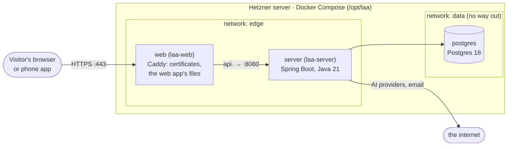
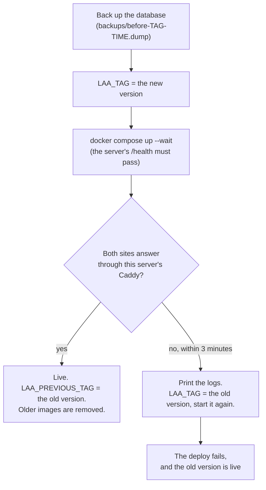
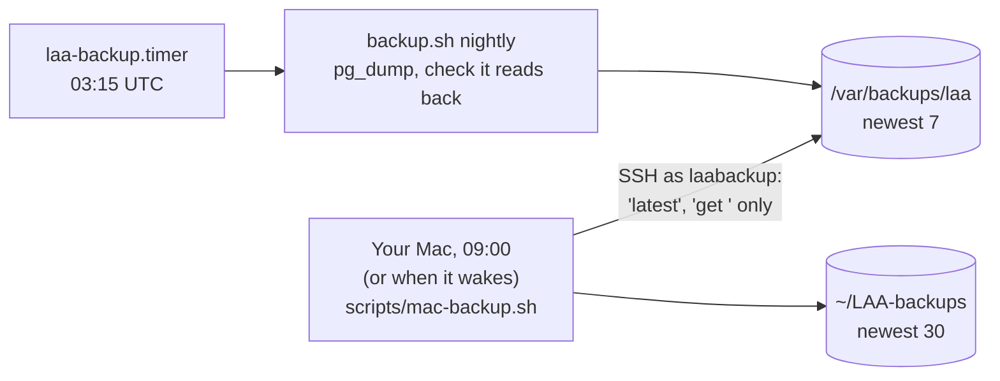

# Deploying: what runs on the server, and how a version goes live

LAA in production is one Hetzner server running three containers. This page covers how they fit together, how a new version goes live and comes back off, and how to restore the database. The whole path from a task to a deploy is in [`WORKFLOW.md`](WORKFLOW.md); the plan that gets us there is [`PRODUCTION-PLAN.md`](PRODUCTION-PLAN.md).

## What runs



- **`web`** is Caddy, holding the exported web app. It answers both addresses, `learnanythinganywhere.app` (the app's files) and `api.learnanythinganywhere.app` (passed on to the server). It fetches and renews the HTTPS certificates itself, and sets the visitor's real address in `X-Forwarded-For`, replacing whatever the visitor sent.
- **`server`** is the Spring Boot jar. It's reached only through Caddy, runs as an unprivileged user on a read-only file system, and gets its settings from `/opt/laa/.env`.
- **`postgres`** keeps its data in the `laa_pgdata` volume. It's on a network with no route out, and nothing outside the server can reach it.

The two images are built from `deploy/server.Dockerfile` and `deploy/web.Dockerfile`. Each has an allowlist (`*.Dockerfile.dockerignore`) of what the build may see, so `.env` can never get into an image. **The web app has the API's address baked in when it's built**, so an image is built for one address.

## On the server

```
/opt/laa/
├── compose.yml          deploy/compose.yml
├── compose.build.yml    deploy/compose.build.yml (only for building on the server)
├── deploy.sh            deploy/deploy.sh
├── .env                 the production settings, root only (chmod 600), from deploy/.env.example
├── backups/             a database copy from just before each of the last 10 deploys
└── src/                 a clone of the repository (only for building on the server)
```

`.env` holds everything: the two addresses, the secrets, the AI keys, the email settings and the spending caps. Compose reads it, and the server gets all of it as its environment. Type the secrets on the server itself. `LAA_TAG` (the live version) and `LAA_PREVIOUS_TAG` are written by `deploy.sh`, so leave them alone. The laptop-only switches (`LAA_DEV_LOGIN`, `LAA_DEV_ENDPOINTS`, `LAA_PRACTICE_PROVIDERS`, `LAA_MAIL_OUTBOX`) never go here.

## Setting up a new server

The production server is `laa-prod-1`, a Hetzner CX23 in Nuremberg on Ubuntu 26.04, at `2.28.71.82` and `2a01:4f8:1c1b:dee5::1`. Its Hetzner Cloud Firewall lets in only TCP 22, 80 and 443, UDP 443 and ping. Everything going out is allowed. A new or rebuilt server is set up like this:

1. **Sign in** with the owner's key: `ssh root@2.28.71.82`.
2. **Run the setup script**, once:
   ```bash
   git clone https://github.com/bernardodr/LearnAnythingAnywhere.git /opt/laa/src
   /opt/laa/src/deploy/bootstrap.sh
   ```
   [`deploy/bootstrap.sh`](../deploy/bootstrap.sh) does the following:
   - installs updates, and installs security updates automatically from then on (restarting at 04:30 UTC when one needs it);
   - allows SSH with a key only, and adds fail2ban;
   - adds 2 GB of swap;
   - installs Docker, with container logs capped;
   - lays out `/opt/laa`, as described in the next section.

   It generates `.env`'s database password, sign-in secret and owner setup code on the server itself, and never prints them. It's safe to run again.
3. **Fill in the rest of `.env`** (`nano /opt/laa/.env`). The script lists what's missing: your owner email, the AI key, and the email password. Keep a copy of the whole file in a password manager. If the server is ever lost, that copy and a database backup are all you need to rebuild it.
4. **Point DNS at the server** (Phase 3, step 4), then **deploy**: `cd /opt/laa && ./deploy.sh build main`.
5. **Create your owner account** in the web app, using `LAA_OWNER_SETUP_CODE` from `.env`.

## Putting a version live

Everything goes through `deploy.sh`, as root in `/opt/laa`:

| Command | What it does |
|---|---|
| `./deploy.sh build [ref]` | Builds both images on the server from `src/` at `ref` (a branch, tag or commit; default `main`), tags them with the commit, then rolls them out. **This is how we deploy until the deploy workflow exists** (Phase 4). |
| `./deploy.sh <tag>` | Rolls out images already built, pulling them from the registry (`LAA_IMAGES`) if they aren't on the server. The deploy workflow will run this. |
| `./deploy.sh rollback` | Goes back to the version before the live one. |
| `./deploy.sh status` | The live and previous versions, and the containers' state. |

Each roll-out does this:



- **Only one deploy runs at a time.** A second one stops with a message. If a deploy was interrupted, remove `/opt/laa/.deploy.lock`.
- **A roll back puts the old code back, not the old data.** A new version may already have changed the database. Older code usually still runs, because migrations only add things, but if it doesn't, restore the backup taken just before (below).
- **The first start of an `https://` address fetches its certificates**, so the DNS records must already point at the server (Phase 3, step 4). The check keeps trying for 3 minutes while that happens.

## Restoring a backup

The backups are in Postgres's own format. To put one back, for example `backups/before-abc123-20261122T155055Z.dump`:

```bash
cd /opt/laa
docker compose stop server                     # nobody writes while it's restored
docker compose exec -T postgres pg_restore -U laa -d laa --clean --if-exists --single-transaction \
  < backups/before-abc123-20261122T155055Z.dump
docker compose start server
```

`--clean` replaces what's there, and `--single-transaction` means a restore that fails changes nothing. Everything written since that backup is lost. If the code that's live is newer than the backup, roll back to the version the backup was taken under, too: the backup's name says which version came *after* it.

## Nightly backups



- **On the server**, `laa-backup.timer` runs `/usr/local/lib/laa/backup.sh nightly` at 03:15 UTC (a run missed while the server was off happens when it's back). It dumps the database, checks that Postgres can read the dump back, and keeps the newest 7 in `/var/backups/laa`. Run one by hand with `systemctl start laa-backup`, and see what happened with `journalctl -u laa-backup`.
- **On your Mac**, `scripts/mac-backup.sh` fetches the newest one every day at 09:00, or as soon as the Mac wakes if it was asleep. It keeps the newest 30 in `~/LAA-backups`, and shows a notification if a fetch fails. `./scripts/mac-backup.sh status` lists the copies and the last runs.
- **The backup key can only fetch backups.** The Mac signs in as `laabackup` with its own key (`~/.ssh/laa_backup`), and the server runs `backup.sh serve` whatever the Mac asks for. That answers exactly two requests, `latest` and `get <backup name>`, with no shell, no other files and no port forwarding (`restrict`). The key has no passphrase, because nobody is there at 09:00 to type one.
- **The copies hold everything** (accounts, password hashes, books, chats). The folder is private to your user; keep FileVault on.
- **A restore drill** loads a copy into a scratch database on your Mac and counts what's in it: `./scripts/restore-drill.sh [file]` (default: the newest). Run it now and then: a backup that has never been restored isn't known to work.

**Setting it up** (once; the setup script installs the server half):

1. On the Mac: `./scripts/mac-backup.sh setup`. It makes the key, schedules the daily fetch, and prints one command.
2. On the server, as root: run that command (`/usr/local/lib/laa/backup.sh allow 'ssh-ed25519 …'`).
3. On the server: `systemctl start laa-backup` for a first backup. Then on the Mac: `./scripts/mac-backup.sh fetch` and `./scripts/restore-drill.sh`.

**Losing the server:** set up a new one (above), deploy, then restore the newest copy from `~/LAA-backups` with the commands in *Restoring a backup*, after copying it up: `scp ~/LAA-backups/<file> root@<server>:/opt/laa/backups/`.

## Trying it locally first

```bash
./e2e/production.sh [screenshot dir]
```

This runs the production setup on your laptop, using the real `compose.yml` and `deploy.sh`. It lays out a scratch folder like `/opt/laa`, with local `http://` addresses and practice mode, and then:

1. builds both images from your working copy and deploys them;
2. checks the stack from outside in headless Chrome (`e2e/production.mjs`): headers, caching, streamed replies, a learner opening a lesson and its diagram, and that a forged `X-Forwarded-For` can't get round the sign-in limit;
3. deploys a second version, which must take a readable backup first;
4. deploys a broken version, which must roll itself back;
5. rolls back by hand, keeping the data;
6. loses the data and restores it from the backup, with the commands above;
7. takes a nightly backup, checks the backup key's forced command refuses everything but its two requests, fetches the backup with the Mac's script, and restores it with the restore drill.

Then it removes everything it started. Run it after any change to `deploy/`.

## When something's wrong

| What you see | What to do |
|---|---|
| A deploy fails and rolls back | It prints the server's last log lines. More with `docker compose logs --tail 200 server`. Fix it in a pull request and deploy again. |
| `https://` doesn't work on a first start | `docker compose logs web`: usually the DNS records don't point here yet, or port 80 or 443 is closed in the Hetzner firewall. |
| The server restarts over and over | `docker compose logs server`. It refuses to start when a required setting is missing (`JWT_SECRET`, an SMTP host, `LAA_DEFAULT_PROVIDER` on a new database), and the message names it. |
| Out of memory | The server has 1.5 GB (75% of it heap), Postgres 768 MB and Caddy 256 MB, in `compose.yml`. Running out of memory ends the server process, and Docker starts it again. |
