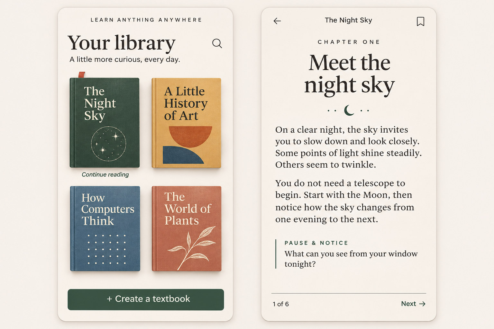

# Design: Warm Editorial Minimalism

**Every change to the app's screens follows this page.** It holds the owner's design brief word for word (2026-11-24), the reference mockups, and how LAA puts them into practice: the tokens in `app/src/theme.ts`, the shared pieces in `app/src/components/ui.tsx`, and the book covers. The brief comes first. Where this page and the brief seem to differ, follow the brief and fix this page.

The mockups show the direction, not a spec. Search, the bookmark and reading time ("About 25 min") aren't built yet (issues #73–#75). Notes and highlights are facelift milestone 4 (#71).

## The brief

> Design a mobile screen for Learn Anything Anywhere, an app that creates small, personalised textbooks.
>
> The visual direction is Warm Editorial Minimalism. The experience should feel like a quiet, beautifully curated personal library: thoughtful, welcoming, tactile and spacious.
>
> Use warm ivory backgrounds (#F7F4EC), dark ink text (#292823) and forest green (#384E41) for primary actions. Introduce muted ochre, dusty blue and terracotta mainly through book covers and subject illustrations.
>
> Use elegant editorial serif typography for headings, book titles and reading content, paired with a clear sans serif for controls and metadata. Source Serif 4 and Inter are the suggested starting typefaces. Establish hierarchy through type size, weight, alignment and generous spacing.
>
> Represent textbooks as carefully designed physical books. Use consistent cover proportions, subtle cloth or paper texture, a hint of spine depth and soft natural shadows. Give each cover a clear title and one restrained subject motif.
>
> Keep the surrounding interface visually simple. Use modestly rounded buttons, fine dividers, clear icons and a small number of prominent controls. Give each screen one visually dominant action, with secondary actions presented quietly.
>
> Design outlines like contents pages, chapter openings like book openings, and reflection prompts like notes in the margin. Keep reading layouts comfortable, with generous line spacing, adaptable text size and clear navigation.
>
> Place detailed texture and depth primarily on the books. Keep text backgrounds even and controls crisp. Use illustration to express a subject or explain a concept.
>
> Write in a calm, encouraging voice that invites curiosity. Use subtle, responsive transitions that support navigation.
>
> Carry forward the typography, palette, book treatment and sense of space from the approved library mockup. Adapt the composition to the new screen's purpose, content and real mobile dimensions.

## Colour

All in `colors` (`app/src/theme.ts`). Contrast was checked against the background each colour sits on, and text is at least 4.5:1.

| Token | Value | Use | Contrast |
|---|---|---|---|
| `paper` | `#F7F4EC` | warm ivory: every screen's background | |
| `ink` | `#292823` | text | 13.4:1 |
| `muted` | `#66615A` | metadata, captions, hints | 5.6:1 (5.1 on `noteFill`) |
| `accent` | `#384E41` | forest green: the primary button, links, the current choice | 8.2:1 |
| `rule` | `#E3DDCF` | fine dividers and field borders | |
| `control` | `#8A8476` | controls drawn on paper, such as a switch's track | 3.4:1 (non-text, 3:1 needed) |
| `noteFill` | `#EFEADF` | quiet panels: notes in the margin, the mission card | |
| `danger` | `#9A3B26` | errors | 6.3:1 |
| `covers.forest` | `#2F4A3B` | cover cloth, ivory title | 8.8:1 |
| `covers.ochre` | `#D4A548` | cover cloth, **ink** title | 6.5:1 |
| `covers.blue` | `#46668A` | dusty blue cover cloth, ivory title | 5.4:1 |
| `covers.terracotta` | `#A9533A` | cover cloth, ivory title | 4.8:1 |

- **Forest green means "do this":** one dominant action per screen, and quieter actions use green text, not a filled button.
- **Ochre, blue and terracotta live on books and illustrations,** not on controls.
- **Backgrounds stay even:** no gradients, textures or shadows behind text. Depth and texture belong to the books.

## Type

`fonts` and `type` in `app/src/theme.ts`.

- **Source Serif 4** for headings, book titles and reading. **Inter** for controls, labels and metadata.
- **Scale:**
  - display 40/44 (a screen's title, like "Your library");
  - h1 32/38; h2 24/31; h3 19/26;
  - reading body 18/30 (adjustable from milestone 3); small serif 16/24;
  - controls 15 (Inter semibold); metadata 13 (Inter).
- **Kickers** (the small caps line above a title, like "LEARN ANYTHING ANYWHERE" and "CHAPTER ONE"): Inter semibold, 11–12, letter-spaced 2–3, uppercase, in `muted` or `ink`.
- **Hierarchy comes from size, weight, alignment and space,** not colour or boxes. Titles may be centred on openings (title page, chapter openings). Working screens align left.

## Space and shape

- Generous space: screen gutters of 24, sections 32–40 apart, and 8 between a label and its field.
- Buttons are **modestly rounded** (radius 10). The primary button is full width on phones, 52 tall, forest green with ivory Inter semibold.
- Fields have a fine `rule` border, radius 10, and a slightly lighter fill (`#FBF9F4`).
- Dividers are hairlines in `rule`.
- Icons are simple line icons (`Icon` in `ui.tsx`), at least 44×44 to tap, each with an accessibility label.

## Books

`BookCover` in `app/src/components/Cover.tsx`, with motifs in `app/src/components/Motif.tsx`.

- **Proportions:** 1 : 1.36 everywhere: grid, book page and thumbnails.
- **The cloth:** the cover colour, a fine woven texture, a soft light from the top left, a hint of spine depth down the left edge (a darker hinge band and a light crease), and a soft natural shadow underneath.
- **The face:** the title in Source Serif 4 semibold, set top-left, large, with ivory or ink to contrast with the cloth. Lower down sits one restrained **motif** in the same colour.
- **Motifs** are a fixed, hand-drawn set of line drawings: stars, moon, leaf, wheat, mountain, wave, gear, dots, shapes, brush, note, flask, atom, globe, quill, column, bars, pulse, pawn, speech, plus a neutral ornament. The AI picks one when the preface ends. Until then (a preface in progress, or a book from before motifs), the server matches one from the title.
- **A ribbon** (terracotta, at the top) marks a book whose preface is still in progress.

## Screens

- **Outlines read like contents pages:** numbered entries, fine dividers, the current entry marked quietly.
- **Chapter openings read like book openings:** a kicker ("CHAPTER ONE"), a large centred serif title, a small ornament, then the text.
- **Reflection prompts read like notes in the margin:** a fine vertical rule on the left, a small green kicker, and serif text, with no box.
- **Reading:** comfortable measure (about 65 characters), generous line spacing, adjustable text size, and clear Previous and Next.
- **Motion** is subtle and supports navigation (a page sliding in, a book lifting when held). It respects reduced motion.

## Voice

Calm and encouraging, and curious. Short sentences. Name things the way people do ("Your library", "Start reading", "Add a note"). Never scold, and keep errors kind and specific about what to do next.
