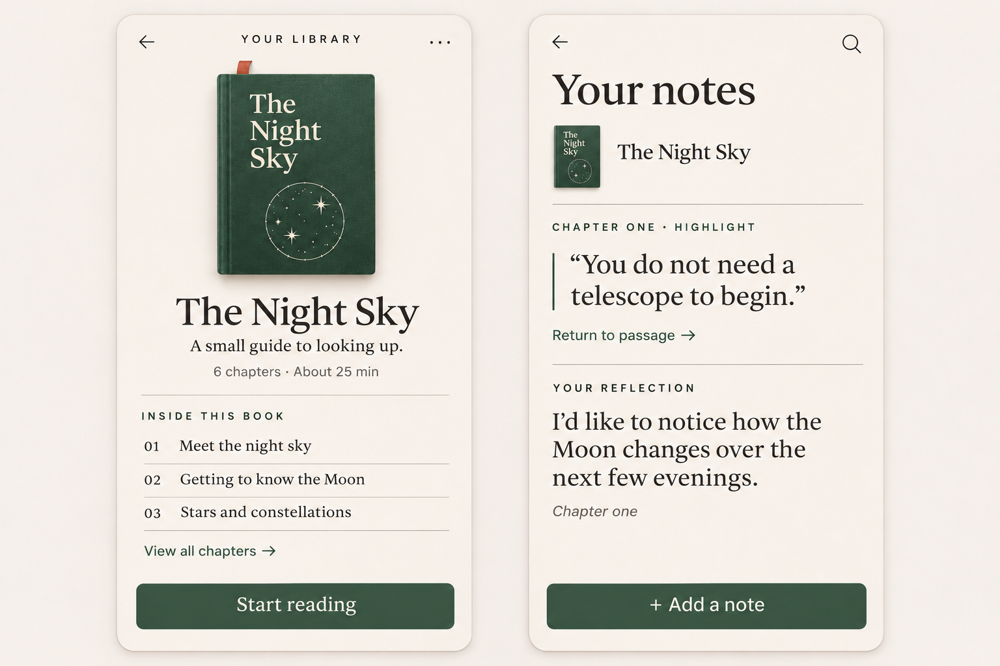

# Design: Warm Editorial Minimalism

**Every change to the app's screens follows this page.** It holds the owner's design brief word for word (2026-11-24), the reference mockups, and how LAA puts them into practice: the tokens in `app/src/theme.ts`, the shared pieces in `app/src/components/ui.tsx`, and the book covers. The brief comes first. Where this page and the brief seem to differ, follow the brief and fix this page.

The mockups show the direction, not a spec. Search, the bookmark and reading time ("About 25 min") aren't built yet (issues #73–#75). Notes and highlights are facelift milestone 4 (#71).

## The brief

> Design a mobile screen for Learn Anything Anywhere, an app that creates small, personalised textbooks.
>
> The visual direction is Warm Editorial Minimalism. The experience should feel like a quiet, beautifully curated personal library: thoughtful, welcoming, tactile and spacious.
>
> Use warm ivory backgrounds (#F7F4EC), dark ink text (#292823) and forest green (#384E41) for primary actions. Introduce muted ochre, dusty blue and terracotta mainly through book covers and subject illustrations.
>
> Use elegant editorial serif typography for headings, book titles and reading content, paired with a clear sans serif for controls and metadata. Source Serif 4 and Inter are the suggested starting typefaces. Establish hierarchy through type size, weight, alignment and generous spacing.
>
> Represent textbooks as carefully designed physical books. Use consistent cover proportions, subtle cloth or paper texture, a hint of spine depth and soft natural shadows. Give each cover a clear title and one restrained subject motif.
>
> Keep the surrounding interface visually simple. Use modestly rounded buttons, fine dividers, clear icons and a small number of prominent controls. Give each screen one visually dominant action, with secondary actions presented quietly.
>
> Design outlines like contents pages, chapter openings like book openings, and reflection prompts like notes in the margin. Keep reading layouts comfortable, with generous line spacing, adaptable text size and clear navigation.
>
> Place detailed texture and depth primarily on the books. Keep text backgrounds even and controls crisp. Use illustration to express a subject or explain a concept.
>
> Write in a calm, encouraging voice that invites curiosity. Use subtle, responsive transitions that support navigation.
>
> Carry forward the typography, palette, book treatment and sense of space from the approved library mockup. Adapt the composition to the new screen's purpose, content and real mobile dimensions.

## Colour

All in `colors` (`app/src/theme.ts`). Contrast was checked against the background each colour sits on, and text is at least 4.5:1.

| Token | Value | Use | Contrast |
|---|---|---|---|
| `paper` | `#F7F4EC` | warm ivory: every screen's background | |
| `ink` | `#292823` | text | 13.4:1 |
| `muted` | `#66615A` | metadata, captions, hints | 5.6:1 (5.1 on `noteFill`) |
| `accent` | `#384E41` | forest green: the primary button, links, the current choice | 8.2:1 |
| `rule` | `#E3DDCF` | fine dividers and field borders | |
| `control` | `#8A8476` | controls drawn on paper, such as a switch's track | 3.4:1 (non-text, 3:1 needed) |
| `noteFill` | `#EFEADF` | quiet panels: notes in the margin, the mission card | |
| `danger` | `#9A3B26` | errors | 6.3:1 |
| `covers.forest` | `#2F4A3B` | cover cloth, ivory title | 8.8:1 |
| `covers.ochre` | `#D4A548` | cover cloth, **ink** title | 6.5:1 |
| `covers.blue` | `#46668A` | dusty blue cover cloth, ivory title | 5.4:1 |
| `covers.terracotta` | `#A9533A` | cover cloth, ivory title | 4.8:1 |

- **Forest green means "do this":** one dominant action per screen, and quieter actions use green text, not a filled button.
- **Ochre, blue and terracotta live on books and illustrations,** not on controls.
- **Backgrounds stay even:** no gradients, textures or shadows behind text. Depth and texture belong to the books.

### Dark mode

The same warmth at night (issue #85; the owner: "a dark mode that still fits the design style"). The learner chooses it
in settings, under **Appearance**: match the device (the default), light, or dark. Text pairs are checked at 4.5:1.

| Token | Dark value | Contrast |
|---|---|---|
| `paper` | `#1B1A17` | a warm near-black, never pure black |
| `ink` | `#EEEAE0` | 14.5:1 |
| `muted` | `#ADA79B` | 7.3:1 (6.2 on `noteFill`) |
| `accent` | `#93B79E` | 7.9:1: a sage forest; the primary button is sage with dark text (7.9:1) |
| `rule` | `#3A372F` | |
| `control` | `#7E786C` | 4.0:1 (non-text, 3:1 needed) |
| `noteFill` | `#2A2823` | |
| `field` | `#23211D` | |
| `danger` | `#E79A80` | 7.7:1 |
| `ribbon` | `#C25F43` | |

- **Books don't change:** covers and spines keep their cloth, leather or linen and title colours (`coverInk`), and the
  plant on the familiarity slider keeps its pot and soil. They're things on a dark table, not chrome.
- **Diagrams follow:** the sealed frame is given the dark palette's CSS variables and `color-scheme: dark`, and its
  contrast guard measures against them.
- **How:** `colors` and `type` read the palette in use; each file's styles are made per palette with `themed()`; the
  root layout redraws the screens when the palette changes and keeps the learner on the screen they were on.

## Type

`fonts` and `type` in `app/src/theme.ts`.

- **Source Serif 4** for headings, book titles and reading. **Inter** for controls, labels and metadata.
- **Scale:**
  - display 40/44 (a screen's title, like "Your library");
  - h1 32/38; h2 24/31; h3 19/26;
  - reading body 18/30 (adjustable from milestone 3); small serif 16/24;
  - controls 15 (Inter semibold); metadata 13 (Inter).
- **Kickers** (the small caps line above a title, like "LEARN ANYTHING ANYWHERE" and "CHAPTER ONE"): Inter semibold, 11–12, letter-spaced 2–3, uppercase, in `muted` or `ink`.
- **Hierarchy comes from size, weight, alignment and space,** not colour or boxes. Titles may be centred on openings (title page, chapter openings). Working screens align left.

## Space and shape

- Generous space: screen gutters of 24, sections 32–40 apart, and 8 between a label and its field.
- Buttons are **modestly rounded** (radius 10). The primary button is full width on phones, 52 tall, forest green with ivory Inter semibold.
- Fields have a fine `rule` border, radius 10, and a slightly lighter fill (`#FBF9F4`).
- Dividers are hairlines in `rule`.
- Icons are simple line icons (`Icon` in `ui.tsx`), at least 44×44 to tap, each with an accessibility label.

## Books

`BookFace` in `app/src/components/Cover.tsx`, with motifs in `app/src/components/Motif.tsx`.

- **Proportions:** 1 : 1.36 everywhere: grid, book page and thumbnails.
- **The binding:** the cover colour bound in a real material, then a soft light from the top left, a hint of spine depth down the left edge (a darker hinge band and a light crease), and a soft natural shadow underneath. **Forest green and terracotta are leather** (a fine pebbled grain with soft mottling), **ochre and dusty blue are linen** (a slubby plain weave): the owner asked for "hyper realistic textures of linen or leather" (2026-11-26). Both come from photographed CC0 materials (`app/assets/covers/README.md`), as overlays of light and dark grain that work on any colour, shown at 256 points per tile and offset per book, so no two covers share a grain. Spines are bound the same way.
- **The face:** the title in Source Serif 4 semibold, set top-left, large, with ivory or ink to contrast with the cloth. Lower down sits one restrained **motif** in the same colour.
- **Motifs** are a fixed, hand-drawn set of line drawings: stars, moon, leaf, wheat, mountain, wave, gear, dots, shapes, brush, note, flask, atom, globe, quill, column, bars, pulse, pawn, speech, plus a neutral ornament. The AI picks one when the preface ends. Until then (a preface in progress, or a book from before motifs), the server matches one from the title.
- **The reading ribbon** (terracotta, out of the top) marks the book read last: the one whose lesson was opened most recently (`readingNow`; the owner's choice, 2026-11-26). Only that book wears it, on its cover, its spine and its page, with "Continue reading" under it in the library, as in the mockup. A book still in its preface says "Preface in progress" under it instead, with no ribbon.
- **A new book's preview:** while a topic is typed, its cover is drawn with the topic as the title (tidied as the server will title it) in the cloth of its volume (`coverForVolume`, which must match the server's order), and the plain ornament. The motif is the AI's to choose at the end of the preface, so the preview never guesses it.

## Screens

- **The top bar** (`TopBar` in `ui.tsx`): a back arrow at the top left, labelled for screen readers ("Back to your library"), and an optional centred kicker saying where you are ("Your library" on a book's page, the book's title in its preface).
- **The one dominant action is pinned at the bottom** (`Page`'s `footer`): one full-width forest button that follows the screen's state, never two at once. On a book's page it's Start reading, Continue reading, or Write lesson *n*; in the preface it's Send, then Write my textbook (and nothing while the mission is being edited). Quieter actions stay in the page as green text.
- **Outlines read like contents pages:** numbered entries, fine dividers, the current entry marked quietly. On a book's page: *01*, *02*… in serif, a muted tick for a lesson read, *Up next* (and its number) in green, and the lesson not yet written in grey italic. The back of the book is lettered entries A–D that fold open, with a count where a page number would be.
- **A book's page reads like the front of a printed book** (the mockup): the cover at about 45% of the column, the title, the mission's one-line goal, a line of facts in Inter (*Volume III · 2 lessons · 1 read*), a fine rule, then *Inside this book*, the why in the margin, and *At the back of the book*.
- **Chapter openings read like book openings:** a kicker ("CHAPTER ONE"), a large centred serif title, a small ornament, then the text. The preface opens the same way: *Preface*, *Before we begin*.
- **Diagrams keep every word readable:** the frame's contrast guard turns HTML text below 4.5:1 against its fill to ink or ivory, whatever the diagram's own CSS chose.
- **Reflection prompts read like notes in the margin** (`MarginNote`): a fine forest rule on the left (2px, since browsers draw 1.5px as 1px), a small green kicker, and serif text, with no box. The learner's own words take the same form: their answers in the preface, and the why of their mission.
- **The mission** is a flat `noteFill` panel set like a dedication page: a green kicker, the goal as a centred heading, the ornament, the why in italic, then its parts under fine rules.
- **Illustration that explains:** the new-book screen's familiarity slider (issue #83) shows a potted plant that grows with the level (a wiggling seed, a sprout, leaves, a bud, a flower with twinkling sparkles), drawn in the palette (forest leaves, an ochre flower, a terracotta pot) with springy pops between levels and a gentle sway; reduced motion keeps the drawing still. The control matches the age stepper in settings: − and + either side of a track, with tappable stops and a draggable handle.
- **A lesson ends with its sources,** like the references after a book's chapter: a fine rule, a *Sources* kicker, then numbered entries (the number in forest green, as the text cites it), each with its title, what it's good for, and its site in small type, and a line saying where they come from. Trust is the point: never a source LAA couldn't check.
- **Reading:** comfortable measure (about 65 characters), generous line spacing, adjustable text size, and clear Previous and Next.
- **Motion** is subtle and supports navigation (a page sliding in, a book lifting when held). It respects reduced motion.

## Voice

Calm and encouraging, and curious. Short sentences. Name things the way people do ("Your library", "Start reading", "Add a note"). Never scold, and keep errors kind and specific about what to do next.

**No em dashes, anywhere** (the owner, 2026-11-26: "a hard filter"). Use a comma, a colon, brackets or a full stop. The app's lint rejects an em dash in any string or JSX text, and the server takes them out of every word an AI writes and every response a learner gets (`Dashes`).
