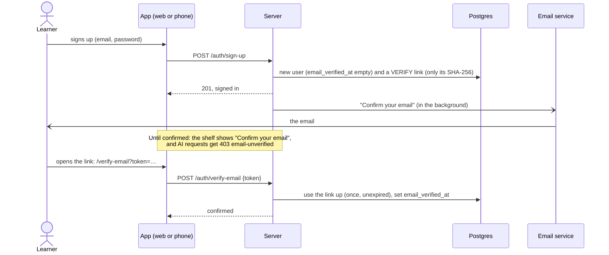
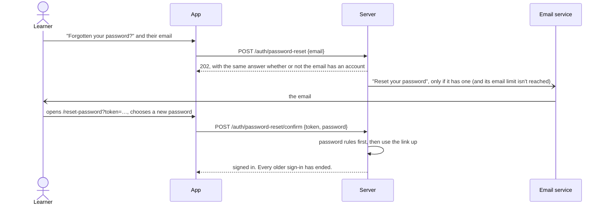
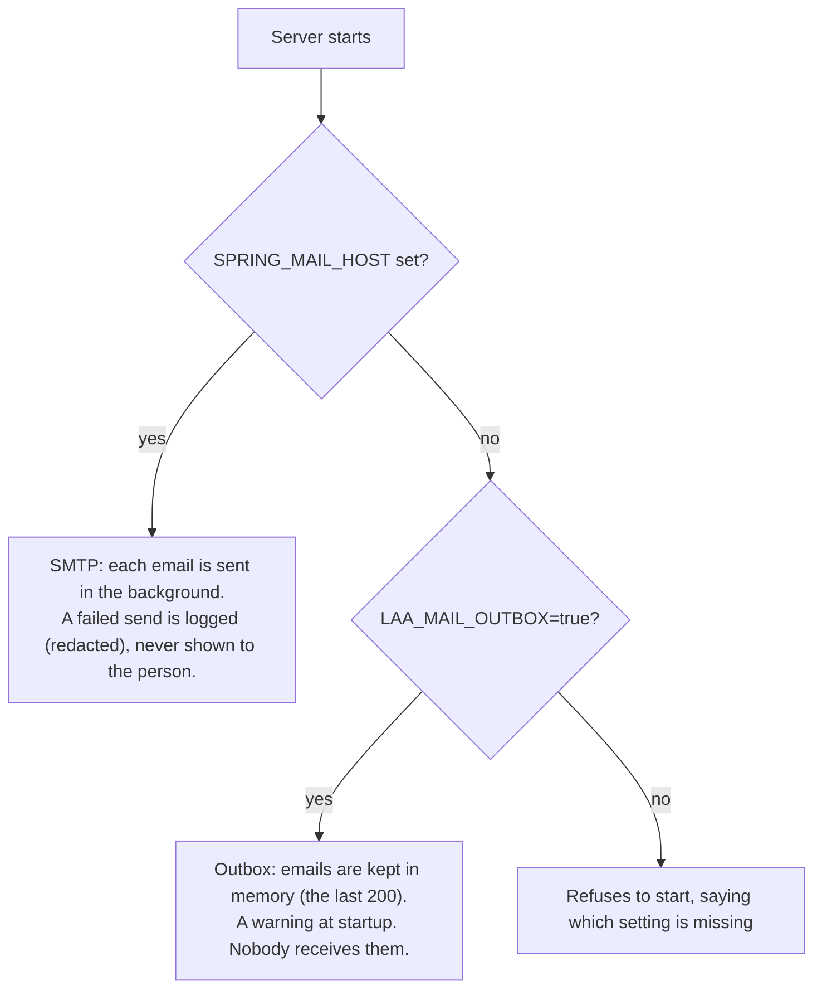

# Email

LAA sends two kinds of email: a link to **confirm your email** after sign-up, and a link to **reset a forgotten password**. Both matter. Until an email is confirmed, the account can't use the AI, which keeps made-up accounts from spending the AI budget. Without the reset link, a forgotten password loses the account. This page is for developers. What learners see is in `docs/product/guide/`.

## The emails

| Email | Sent when | The link | Works for | After it's used |
|---|---|---|---|---|
| **Confirm your email** | Sign-up, or *Send the link again* (signed in, unconfirmed only) | `{LAA_APP_URL}/verify-email?token=…` | 24 hours, once | The email is confirmed, and the AI is unlocked |
| **Reset your password** | *Forgotten your password?* on the title page | `{LAA_APP_URL}/reset-password?token=…` | 30 minutes, once | A new password is set, **every other sign-in ends**, the email counts as confirmed, and the person is signed in |

Both are plain text, from `LAA_MAIL_FROM`, written in `Accounts` (`sendVerification`, `requestPasswordReset`).

## How the flows work

### Sign-up and confirming



### Forgotten password



## The links (`auth/EmailLinks`)

- **A token is 256 random bits**, sent in the link. The database keeps only its **SHA-256** (`email_tokens.token_hash`), so someone reading the database can't use a link.
- **One use, then gone:** using a link is a single `UPDATE … RETURNING`, so it works once even if two requests race. It must also be unexpired.
- **A new link cancels the older ones** for the same purpose.
- **A reset checks the new password first** (`peek`), and uses the link up only when the password passes. So a too-short password doesn't waste the link.
- **The links point at the web app** (`LAA_APP_URL`). Links that open the phone app (universal links and app links) come later: issue #51.

## Limits (`auth/Throttle`)

Each limit is per 15 minutes:

| What | Limit | Why |
|---|---|---|
| Emails to one address | 3 | Nobody can flood someone's inbox through LAA |
| Reset requests from one network address | 10 | Stops sweeping through lists of emails |
| Sign-ups from one network address | 5 | Stops making accounts in bulk |

**A reset request never tells you whether the email has an account:** the answer is the same every time, even when the email limit means nothing is sent. Behind the production proxy, "network address" means the visitor's own address, not the proxy's (`forward-headers-strategy` in `application.yml`).

## Sending (`mail/Mailer`)



- **Sent in the background** so a request never waits for the email service, and its timing doesn't reveal whether an email went out.
- **Never logged:** the body (it holds a working link), the link, or the address.
- **The outbox exists for tests** (`application-test.yml` turns it on) and for a local run with no Mailpit.

## Where email goes, by setup

| Setup | Email service | Read the emails |
|---|---|---|
| **Tests** | the in-memory outbox | `mailer.outbox()`; `emailedToken(email, "/verify-email")` reads a link's token |
| **`./dev.sh`** | **Mailpit** (a local catch-all, in `docker-compose.yml`): `localhost:1025` | http://localhost:8025. Nothing leaves your machine. |
| **Local, with Cloudflare** | `SPRING_MAIL_*` set in `.env` (`./dev.sh` then uses it instead of Mailpit) | your real inbox |
| **Production** | **Cloudflare Email Sending** (plan decision D8) | the person's inbox |

Settings (in `.env`; on the server, in `/opt/laa/.env`):

```
SPRING_MAIL_HOST=smtp.mx.cloudflare.net
SPRING_MAIL_PORT=465
SPRING_MAIL_SSL_ENABLED=true      # port 465 is encrypted from the start; 587 would use STARTTLS instead
SPRING_MAIL_USERNAME=api_token    # literally this word
SPRING_MAIL_PASSWORD=<a Cloudflare API token with "Email Sending: Edit">
LAA_MAIL_FROM="Learn Anything Anywhere <support@learnanythinganywhere.app>"   # quoted
LAA_APP_URL=https://learnanythinganywhere.app
```

How to set up Cloudflare (Email Routing for `support@`, Email Sending, the DNS records and the token): [issue #29](https://github.com/bernardodr/LearnAnythingAnywhere/issues/29#issuecomment-6963876354).

## Tests

| Test | Covers |
|---|---|
| `auth/EmailLinksTest` | **The flows:** a link confirms once; links expire; a new link replaces the old; a reset checks the rules first, ends older sign-ins and works once; the same answer for an unknown email; the three limits above |
| `llm/AllowanceTest` | **The AI gate:** an unconfirmed account is blocked until it confirms, and nothing reaches a model |
| `mail/MailerSetupTest` | **Startup:** refuses without an email service unless the outbox is on, and an SMTP host alone is enough |
| `mail/MailerSmtpTest` | **Real sending:** through a Mailpit container, read back from Mailpit's API (subject, sender, recipient, link) |

## Gotchas

- **Quote `LAA_MAIL_FROM` in `.env`.** Unquoted, the spaces and `<>` break `source .env`, and with it `./dev.sh`.
- **Port 465 needs `SPRING_MAIL_SSL_ENABLED=true`.** Without it the connection fails with "Exception reading response".
- **New Cloudflare accounts have a small daily sending limit** that grows over time. Before the domain is set up under Email Sending, Cloudflare only delivers to addresses you've verified in Email Routing.
- **Changing the text of an email** happens in `Accounts`. Keep the plain words, the link on its own line, and the "works once, for …" line, because tests look for the link.
