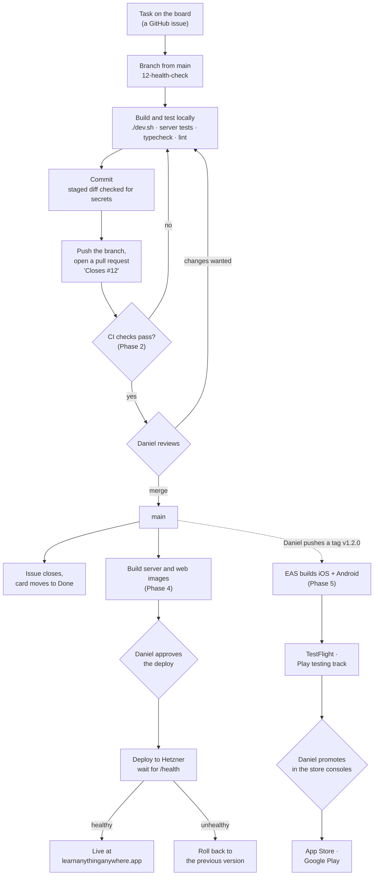
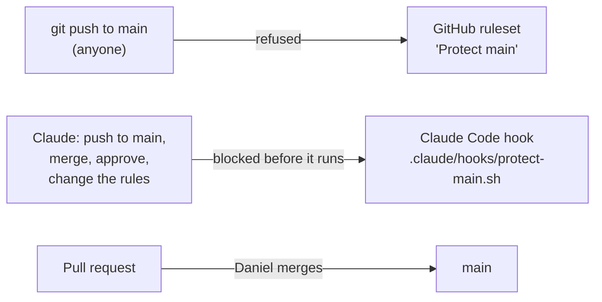
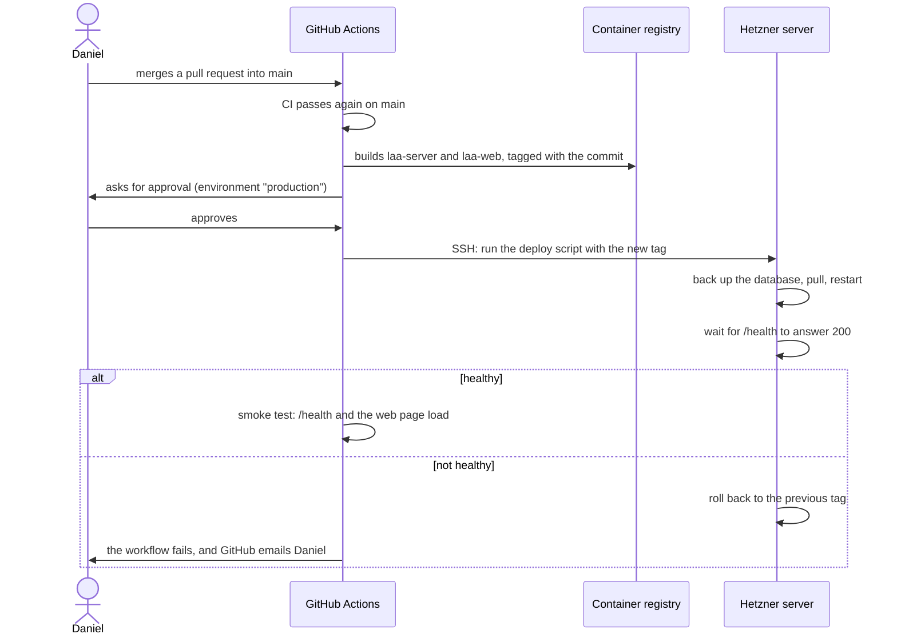

# How work gets from an idea to people's hands

How LAA is developed, reviewed, deployed and released. It's for Daniel (the owner, and the only one who merges) and for Claude (who builds). The diagrams are Mermaid, which GitHub draws.

Parts marked **(Phase N)** are planned in `docs/PRODUCTION-PLAN.md` and not built yet. Until they are, those steps happen by hand or not at all.

## The whole path



## Who does what

| Step | Claude | Daniel |
|---|---|---|
| Tasks | Opens issues for new work, moves cards to *In Progress* | Decides what's next, adds ideas as issues |
| Building | Branch, code, tests, docs, commits | Answers questions; supplies keys (in `.env`, never in chat) |
| Pull requests | Pushes the branch and opens the pull request, with a summary and the test results | **Reviews and merges.** Nobody else can. |
| Deploys (Phase 4) | Writes and fixes the pipeline | **Approves** each deploy in GitHub |
| Store releases (Phase 5) | Prepares the version bump | **Pushes the version tag**, then **promotes** the build in App Store Connect and Play Console |
| Settings and accounts | Writes click-by-click steps | GitHub settings, the branch rule, stores, Hetzner, DNS, money |

## Day to day

### 1. Pick a task

- The board is [LAA production](https://github.com/users/bernardodr/projects/1). Every issue in the repo is a card, and each phase is a parent issue with its steps as sub-issues.
- Issues labelled `you` are Daniel's own steps (accounts, payments, settings, legal).
- **The repo is public, and so are its issues.** Never put a key, a password, a person's details or a security weakness in an issue. Report weaknesses privately instead (*Security → Advisories*).

### 2. Branch

Start from an up-to-date `main`. Name the branch after the issue's number and a few words:

```sh
git switch main && git pull
git switch -c 12-health-check
```

### 3. Build and check locally

| What | Command |
|---|---|
| Run everything (Postgres, Mailpit, server, web app) | `./dev.sh` |
| Server tests (need Docker) | `cd server && ./mvnw test` |
| App typecheck and lint | `cd app && npm run typecheck && npx expo lint` |

A change is ready when the server tests pass, the typecheck and lint are clean, and the docs are updated. Anything people can see needs an entry in the user guide and in `docs/product/release-notes.md`, and `docs/PROGRESS.md` records what was done. See `CLAUDE.md` for the full conventions.

### 4. Commit, without secrets

- **`.env` is never committed.** Only `.env.example` is, and it holds no values.
- **Before every commit, check the staged diff** for env files, any value from `.env`, and anything shaped like a key. Once something is pushed to this public repo, it's published.
- Write messages that say what changed and why, in a short first line.

### 5. Open a pull request

```sh
git push -u origin 12-health-check
gh pr create --base main --fill --assignee @me
```

- **Assign it to Daniel** (`--assignee @me` above, when the pull request is opened with his sign-in). GitHub never lists your own pull request under *Review requests*, so the assignment is what puts it under **Pull requests → Assigned to you**.
- Write **`Closes #12`** in the description. Merging then closes the issue, and its card moves to *Done*.
- Say what changed, how it was tested, and anything the reviewer should try.
- **CI (Phase 2)** runs the server tests, the typecheck, lint and a web build on every pull request. Until it exists, the description lists the results of the local runs.

### 6. Review and merge (Daniel)

- Read the summary and the changes (*Files changed*), and try it if it's visible (`./dev.sh` on the branch: `gh pr checkout 12`).
- Comment for changes, or merge. **Squash and merge** is the suggested default: one commit per pull request keeps `main`'s history readable.
- Delete the branch after merging (GitHub offers a button).

## What protects `main`



- **The ruleset *Protect main*** (GitHub → Settings → Rules) applies to everyone, Daniel included. It allows changes only through a pull request, with no force pushes and no deleting `main`. It requires 0 approvals, because GitHub never lets anyone approve their own pull request, and Claude's pull requests are opened with Daniel's sign-in. **Daniel reviews by merging.**
- **The hook** stops Claude from pushing to `main`, merging or approving a pull request, or changing the branch rules. It runs inside Claude Code before every shell command. It catches mistakes; the ruleset is the real lock.
- **After Phase 2**, the CI checks are added to the ruleset as required, so a pull request with a failing check can't be merged.

## Deploying the server and web (Phase 4)



- **Until this workflow exists** (Phase 4), Daniel deploys by hand on the server: `./deploy.sh build main` builds both images there from `main` and rolls them out with the same checks and roll back. What runs and how: [`DEPLOYING.md`](DEPLOYING.md).
- **Production secrets live only on the server**, in `/opt/laa/.env`, which only root can read. GitHub holds just the deploy key, the server's address and `EXPO_TOKEN`.
- **Rolling back by hand:** run the *Roll back* workflow in GitHub Actions and pick an earlier version (Phase 4).

## Releasing the phone apps (Phase 5)

1. Merge everything the release needs into `main`.
2. Raise the version people see in `app/app.json` (e.g. `1.2.0`), in a pull request like any other change. Build numbers go up by themselves.
3. **Daniel** tags the merged commit and pushes the tag:
   ```sh
   git switch main && git pull
   git tag v1.2.0 && git push origin v1.2.0
   ```
4. GitHub Actions has EAS build both apps and send them to TestFlight and Play's testing track.
5. **Daniel** checks the builds on a phone, then promotes them in App Store Connect and Play Console. The stores review them before they go live.

The web app needs no tag: every approved deploy updates it.

## When something goes wrong

| Problem | What to do |
|---|---|
| CI fails on a pull request | Fix it on the same branch and push again; the checks rerun. |
| A deploy is unhealthy | It rolls itself back. Read the failed workflow's log, fix it, and merge again. |
| Production is broken after a healthy deploy | Run *Roll back* (Phase 4), then fix forward through a pull request. |
| A secret was committed or pushed | **Rotate it at the provider first**, because deleting the commit doesn't unpublish it. Then remove it from the code. |
| An urgent fix | Same path, just smaller: a branch, a pull request, a merge. There's no shortcut onto `main`. |
